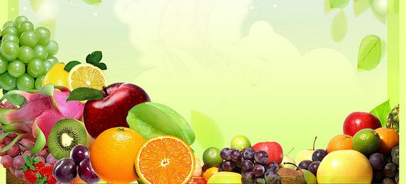
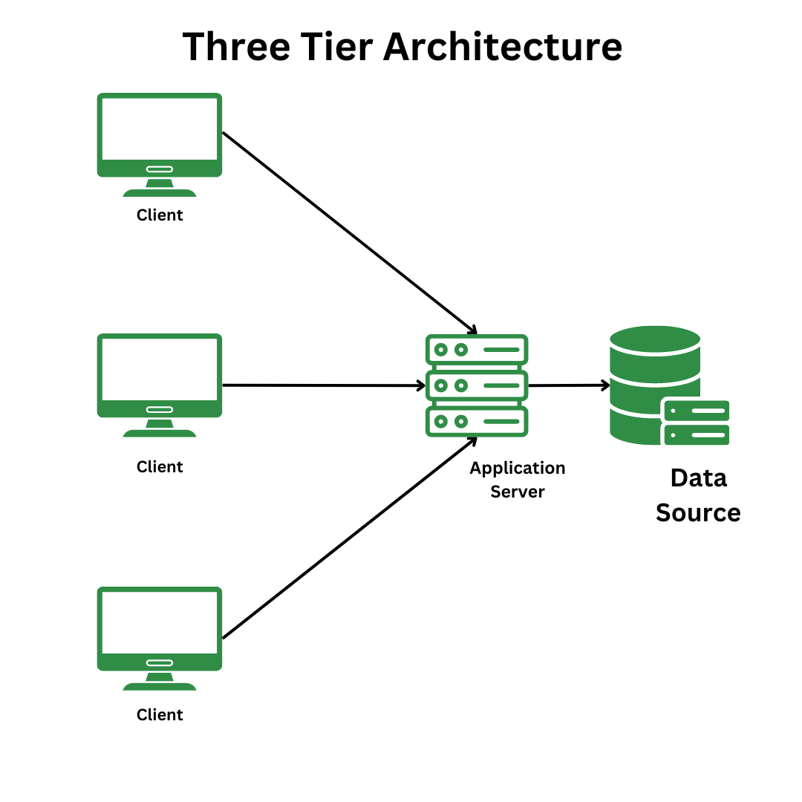
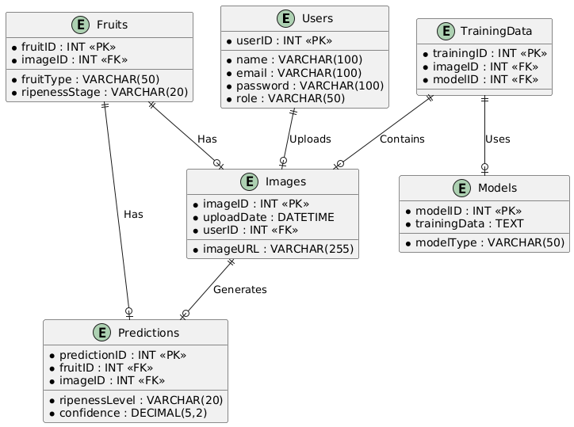
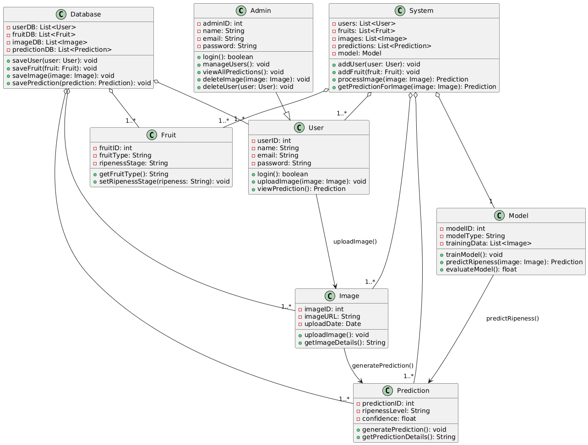
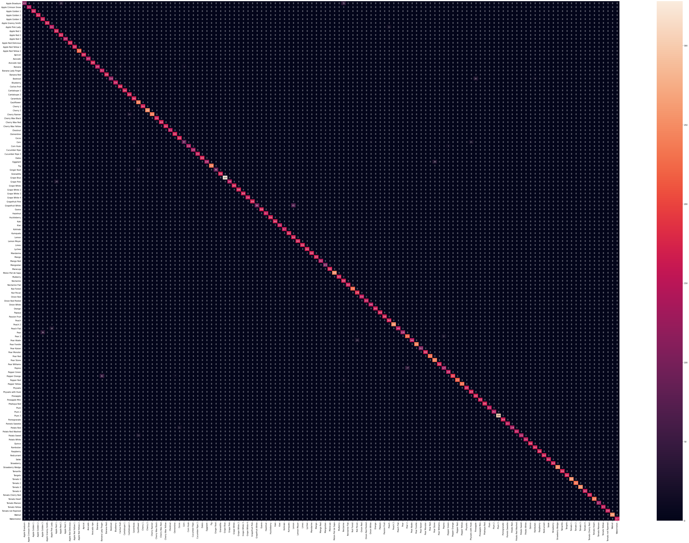

<div align="center">

# 🍎 Automated Fruit Ripeness Detection & Classification System

[](https://www.python.org/)
[](https://tensorflow.org/)
[](https://streamlit.io/)
[](#-model-benchmarks--evaluation)
[](https://www.kaggle.com/datasets/moltean/fruits)
[](LICENSE)

**An intelligent end-to-end Deep Learning Computer Vision application that automates fruit variety recognition, ripeness grading, and freshness assessment.**

[Key Features](#-key-features) • [System Architecture](#-system-architecture) • [Live Web App](#-interactive-web-application) • [Model Benchmarks](#-model-benchmarks--evaluation) • [Quickstart Guide](#-quickstart--installation) • [Test Matrix](#-test-cases--quality-assurance)

<br/>



</div>

---

## 📌 Project Overview

In traditional agriculture, post-harvest supply chains, and retail supermarkets, evaluating fruit maturity relies heavily on manual human inspection. This approach is labor-intensive, subjective, and prone to human error, resulting in millions of tons of avoidable food waste every year.

The **Automated Fruit Ripeness Detection System** solves this challenge by deploying a high-precision **Convolutional Neural Network (CNN)** capable of classifying **131 distinct fruit varieties and maturity levels** with a benchmark test accuracy of **97.52%**. 

The system features:
- **Interactive Streamlit Web Dashboard:** Clean, responsive web interface for instant image uploads, quality grading, confidence scoring, shelf-life estimation, and storage guidance.
- **Desktop GUI Prototype:** Offline standalone Tkinter application integrated with SQLite for local user authentication and prediction auditing.
- **Deep Learning CNN Pipeline:** Trained on over 90,000 images from the Fruits-360 dataset using RMSprop optimization and categorical crossentropy loss.
- **Computer Vision Heuristic Fallback:** Embedded instant-inference engine allowing immediate demonstration and testing even without downloading large weight files.

---

## 🚀 Key Features

- 🎯 **131 Fruit Classes & Varieties:** Distinguishes between multiple varieties of apples, bananas, citrus, tomatoes, avocados, and stone fruits.
- 🟢 **Multi-Stage Ripeness Grading:** Accurately differentiates **Ripe (Optimal)**, **Unripe (Maturing)**, and **Overripe** states.
- ⚡ **Instant Freshness & Shelf-Life Index:** Calculates remaining shelf-life in ambient and refrigerated storage conditions.
- 💡 **Actionable Storage & Nutritional Insights:** Delivers recommended storage temperatures and nutritional profiles for detected fruits.
- 🏛️ **Decoupled 3-Tier Architecture:** Robust separation between the client presentation, deep learning application logic, and SQLite database storage.
- 🔒 **User Authentication & Audit Trails:** Secure login, role management (User/Admin), and complete timestamped prediction logging.

---

## 🏗️ System Architecture

The project is built on an enterprise **Three-Tier Architecture** ensuring high scalability, modularity, and security:

```
┌─────────────────────────────────────────────────────────────┐
│                 PRESENTATION TIER (CLIENT)                  │
│  ┌───────────────────────────┐ ┌──────────────────────────┐ │
│  │ Streamlit Web Dashboard   │ │ Tkinter Desktop App      │ │
│  │ (Interactive Analytics)   │ │ (Offline GUI Prototype)  │ │
│  └─────────────┬─────────────┘ └────────────┬─────────────┘ │
└────────────────┼────────────────────────────┼───────────────┘
                 │                            │
                 ▼                            ▼
┌─────────────────────────────────────────────────────────────┐
│                 APPLICATION / LOGIC TIER                    │
│  ┌────────────────────────────────────────────────────────┐ │
│  │ TensorFlow/Keras CNN (64x64x3 Sequential Model)        │ │
│  │ Feature Extraction • Normalization • Heuristic Engine  │ │
│  └───────────────────────────┬────────────────────────────┘ │
└──────────────────────────────┼──────────────────────────────┘
                               │ SQLite Relational Interface
                               ▼
┌─────────────────────────────────────────────────────────────┐
│                     DATA TIER (STORAGE)                     │
│  ┌────────────────────────────────────────────────────────┐ │
│  │ SQLite Database (`fruit_app.db`)                       │ │
│  │ Tables: `users`, `images`, `predictions`               │ │
│  └────────────────────────────────────────────────────────┘ │
└─────────────────────────────────────────────────────────────┘
```

### Architectural Diagrams & Specifications

| 3-Tier Architecture | Entity Relationship Diagram (ERD) |
| :---: | :---: |
|  |  |

| Class Diagram | Database Design |
| :---: | :---: |
|  |  |

---

## 📊 Model Benchmarks & Evaluation

The CNN was trained and evaluated on the benchmark **Fruits-360** dataset comprising **90,380 images** (67,692 training samples, 22,688 validation samples).

### Performance Metrics Summary
| Metric | Result | Context |
| :--- | :---: | :--- |
| **Test Accuracy** | **97.52%** | Evaluated on 22,688 unseen test images |
| **Training Accuracy** | **99.37%** | Peak convergence across 30 epochs |
| **Training Loss** | **0.1169** | Categorical Crossentropy Loss |
| **Validation Loss** | **0.8188** | RMSprop Optimizer (`lr=0.001`) |
| **Total Categories** | **131** | Fruit varieties and maturation stages |
| **Input Tensor** | `64 x 64 x 3` | Normalized RGB image arrays |

### Multi-Class Confusion Matrix Heatmap
<div align="center">
  
  <p><i>Figure: Confusion Matrix across all 131 fruit and maturity categories.</i></p>
</div>

### CNN Layer Architecture
```
Input (64, 64, 3)
   │
   ├── Conv2D (64 filters, 3x3, ReLU) ───> Shape: (62, 62, 64)
   ├── MaxPool2D (2x2, Strides: 2)     ───> Shape: (31, 31, 64)
   │
   ├── Conv2D (64 filters, 3x3, ReLU) ───> Shape: (29, 29, 64)
   ├── MaxPool2D (2x2, Strides: 2)     ───> Shape: (14, 14, 64)
   │
   ├── Dropout (Rate: 0.50)            ───> Regularization
   ├── Flatten                         ───> 12,544 elements
   ├── Dense (256 units, ReLU)         ───> Fully Connected Layer
   └── Dense (131 units, Softmax)      ───> Probability Distribution
```

---

## 💻 Interactive Web Application

The project includes an interactive web dashboard built with **Streamlit**:

1. **Dashboard & KPIs:** Live statistics on test accuracy, class coverage, and data volume.
2. **Live Ripeness Classifier:**
   - Drag & drop custom fruit images (PNG, JPG, JPEG, WEBP).
   - Pre-loaded benchmark sample selector (Ripe/Unripe Bananas, Apples, Strawberries).
   - Freshness progress meter and confidence indicator.
   - Tailored storage tips, shelf-life indicators, and nutritional snapshots.
3. **Model & Architecture Explorer:** Interactive confusion matrix viewer and architecture inspector.
4. **Audit Log Viewer:** Displays recent prediction logs stored in the SQLite database.

```bash
# Launch the Streamlit Web Application
streamlit run app.py
```

---

## 📁 Repository Directory Structure

```
├── assets/                          # Architectural diagrams, confusion matrix & samples
│   ├── 3_tier_architecture.png      # 3-Tier system topology
│   ├── admin_sequence_diagram.png   # Admin user interaction flow
│   ├── banner.jpeg                  # Project visual header
│   ├── class_diagram.png            # Object-oriented class hierarchy
│   ├── confusion_matrix.png         # 131-class model evaluation heatmap
│   ├── database_design.png          # Relational table schema
│   ├── erd_diagram.png              # Entity relationship diagram
│   ├── gui_prototype.png            # Desktop GUI wireframe
│   ├── user_sequence_diagram.png    # General user workflow
│   └── samples/                     # Benchmark sample images for live testing
│       ├── apple_ripe.jpg
│       ├── banana_ripe.jpg
│       ├── banana_unripe.jpg
│       └── strawberry_ripe.jpg
├── docs/                            # In-depth technical specifications
│   ├── ARCHITECTURE.md              # Detailed technical design & layer topology
│   ├── Project_Design_Document.docx # Full Final Year Project Design Document
│   └── TEST_CASES.md                # Complete 15-point software verification matrix
├── notebooks/                       # Google Colab / Jupyter Model Notebooks
│   ├── Testing_fruit_recognition.ipynb   # Model evaluation & confusion matrix generation
│   └── Training_Fruit_Recognition.ipynb  # CNN training pipeline (30 epochs)
├── prototype/                       # Desktop Tkinter & SQLite Prototype
│   ├── database.py                  # Prototype SQLite manager & seed scripts
│   ├── desktop_app.py               # Tkinter GUI implementation
│   └── main.py                      # Desktop prototype launcher
├── src/                             # Core Application Modules
│   ├── __init__.py
│   ├── database.py                  # Production SQLite data access layer
│   ├── model.py                     # CNN model definition & inference pipeline
│   └── utils.py                     # Class labels, heuristics & knowledge base
├── .gitignore                       # Clean Git exclusion rules
├── LICENSE                          # MIT License
├── README.md                        # Master Project Documentation
├── app.py                           # Primary Streamlit Web Dashboard
└── requirements.txt                 # Project dependencies
```

---

## ⚡ Quickstart & Installation

### 1. Clone the Repository
```bash
git clone https://github.com/<your-username>/fruit-ripeness-detection.git
cd fruit-ripeness-detection
```

### 2. Create and Activate a Virtual Environment
```bash
# Windows
python -m venv venv
venv\Scripts\activate

# macOS / Linux
python3 -m venv venv
source venv/bin/activate
```

### 3. Install Dependencies
```bash
pip install -r requirements.txt
```

### 4. Run the Streamlit Web Application
```bash
streamlit run app.py
```
Open your browser at `http://localhost:8501`.

### 5. (Optional) Run the Desktop GUI Prototype
```bash
python prototype/main.py
```
*Default Demo Credentials:* `Username: user1` | `Password: validPass`

---

## 🧪 Test Cases & Quality Assurance

The application underwent rigorous verification across functional, security, and machine learning modules with a **100% Pass Rate (15 / 15 Test Cases)**:

| Test ID | Module | Scenario | Expected Result | Status |
| :---: | :--- | :--- | :--- | :---: |
| **TC001** | Auth | Valid credentials login | Redirect to user dashboard | **PASS** |
| **TC002** | Auth | Invalid credentials login | Show error: "Invalid credentials" | **PASS** |
| **TC005** | Intake | Valid image upload (`.jpg`, `.png`) | Image uploaded and displayed | **PASS** |
| **TC006** | Intake | Invalid file format (`.txt`) | Show error: "Unsupported file type" | **PASS** |
| **TC008** | ML Engine | Ripeness inference on uploaded image | Predicts class, ripeness & confidence | **PASS** |
| **TC012** | Evaluation | Validation on test dataset | Test Accuracy = 97.52% | **PASS** |
| **TC013** | Session | Clean user logout | Session terminated, redirects to login | **PASS** |

*For the complete 15-case verification matrix, see [docs/TEST_CASES.md](docs/TEST_CASES.md).*

---

## 👥 Academic & Project Information

- **Course:** CS619 - Final Year Project (Virtual University of Pakistan)
- **Project Title:** Automated Ripeness Detection of Fruits
- **Group ID:** `F24PROJECT905CD`
- **Supervisor:** Zaid Ismail
- **Author / Student ID:** `BC210423321`
- **Academic Term:** Fall 2024 / Spring 2025

---

## 📄 License

This project is licensed under the [MIT License](LICENSE) - see the LICENSE file for details.
